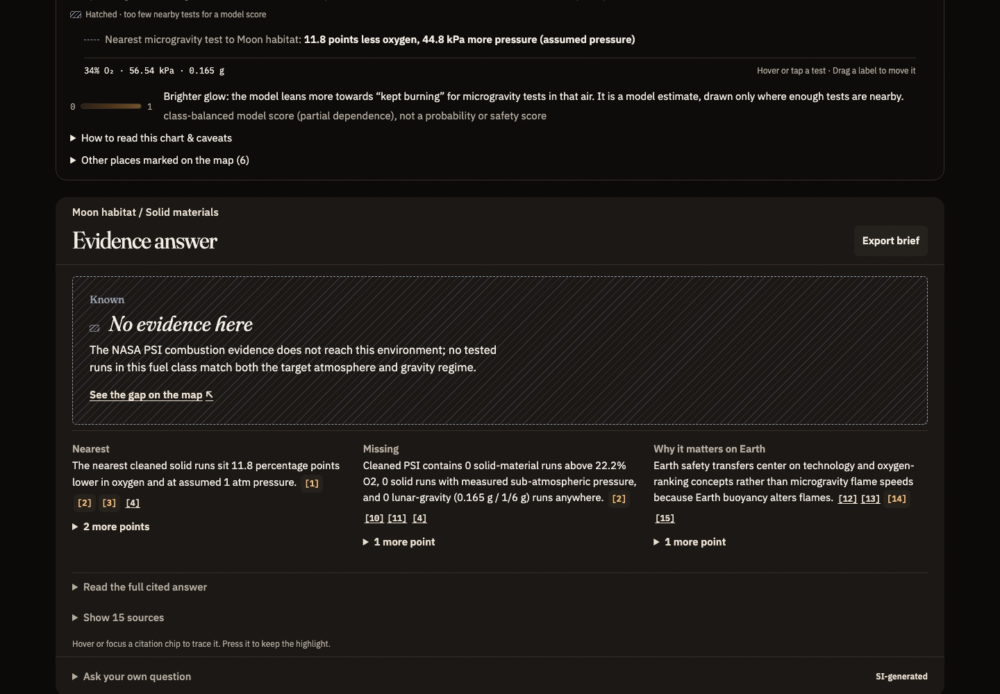
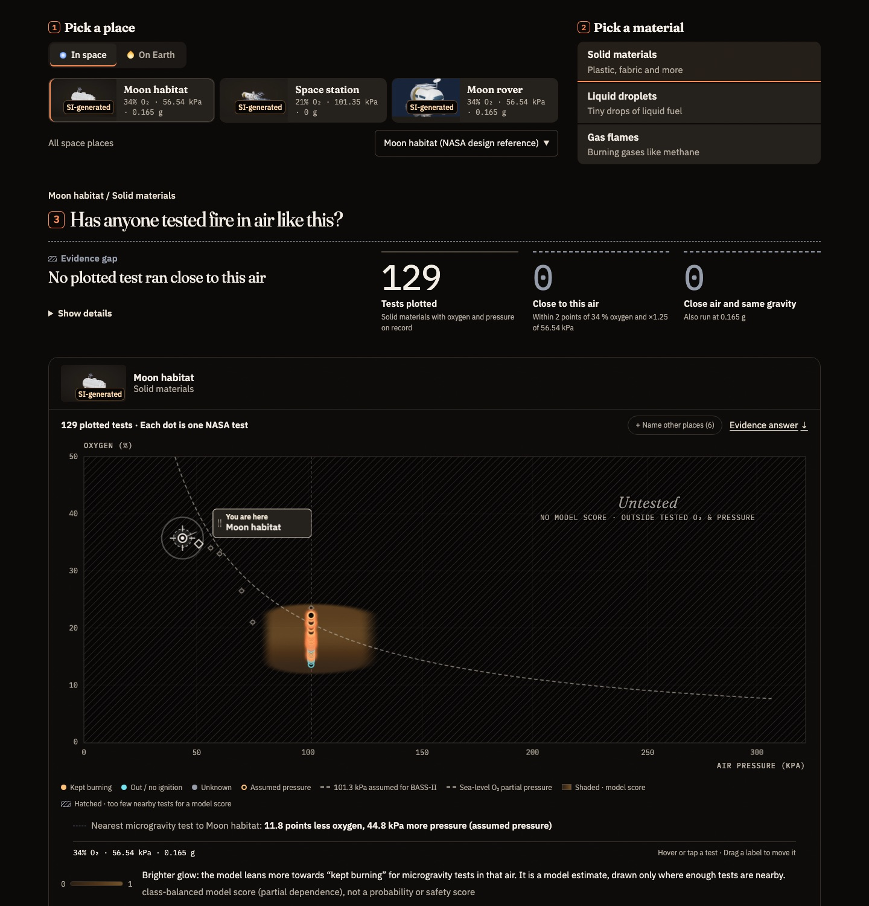
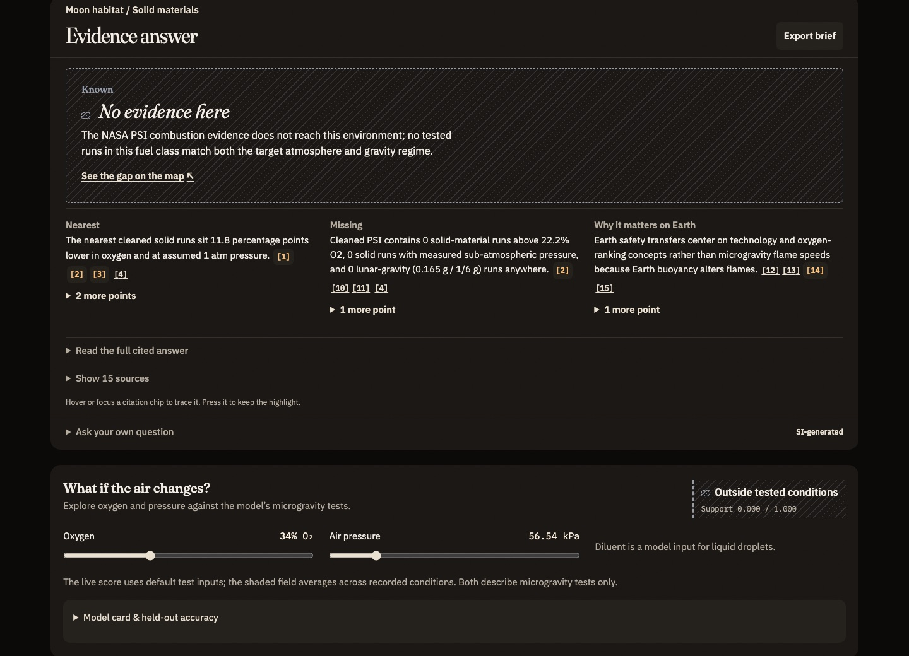
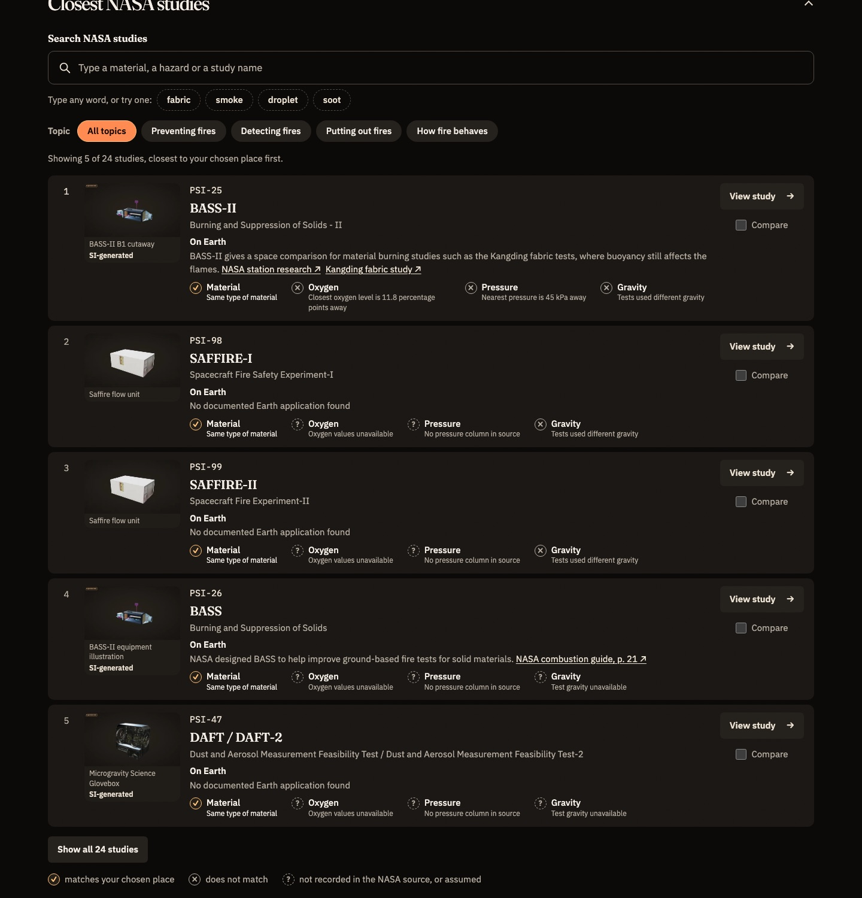
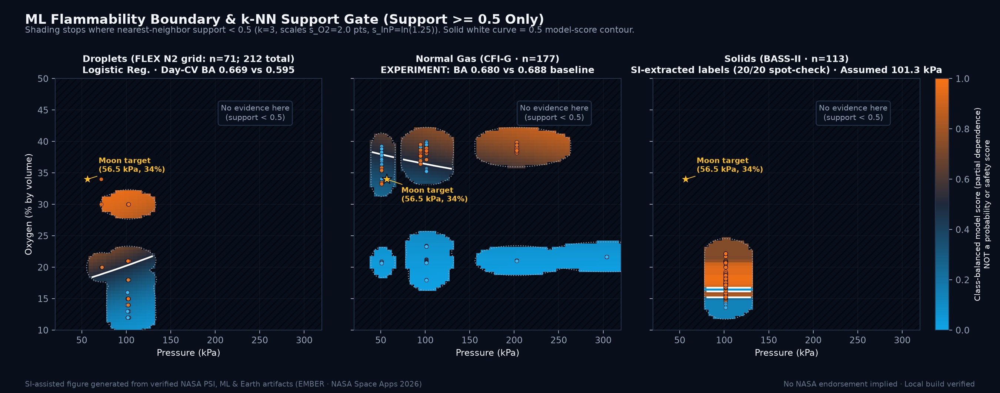
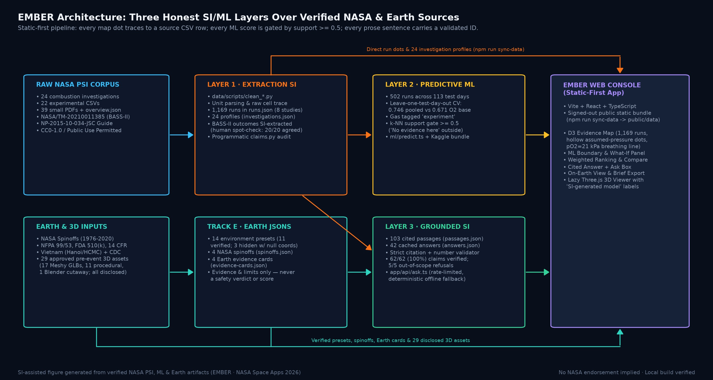

# EMBER — fire evidence map

NASA Space Apps Challenge 2026 · **Flame in Freefall: SI-Powered Fire Safety Insights from Microgravity Combustion Data**

> **If a fire starts in a Moon habitat, what will it do?**
> EMBER shows what NASA's microgravity combustion experiments say about that, and just as clearly, what nobody has tested yet.

## Links

| | |
|---|---|
| **Kaggle dataset** (cleaned PSI runs + training table) | https://www.kaggle.com/datasets/chuongdo2710/nasa-psi-microgravity-combustion-runs |
| **Source data** | NASA Physical Sciences Informatics (PSI), https://psi.nasa.gov |

## What it is

EMBER is a web dashboard for any enclosed place where people breathe: a Moon habitat, a rover, the ISS, a hospital oxygen ward, a hyperbaric chamber, an airliner cabin. You pick a place and a material, and EMBER answers one question:

**What does NASA's microgravity combustion evidence say fire will do here, and what is still unknown?**

It works with real data only. Every number on screen traces to a row in a NASA PSI table or a page in a NASA report. Missing stays missing. EMBER never claims that microgravity results equal Moon or Earth behaviour, and it has no "safety score".

## Screenshots

Moon habitat, solid materials, as the app shows them today.



**Pick a place and a material, then read the evidence map.** Each dot is one NASA test. The hatched area is where there are too few tests for the model to say anything.



**A cited answer.** Here the honest result is "No evidence here". Every numbered chip links to a source.



**NASA studies ranked by how close their tests come to your place.**



## How the website works

The page reads top to bottom as one argument. Each step uses the choices you made in the first one.

1. **Pick a place and a material.** The hero offers one-click places (Moon habitat, rover, ISS and others) and three fuel classes: solids, liquid droplets, gases. The choice is kept in the URL (`?env=…&fuel=…`), so any view can be shared as a link.
2. **Read the evidence map.** Every experimental run in the collection is one dot, plotted by oxygen % (across) against pressure in kPa (up). Your place is a marker on the same chart. A dashed line goes to the nearest tested conditions and states the real oxygen and pressure gap. Hollow dots are runs whose pressure is an assumed, cited value. Press any dot to open the run and its source study.
3. **See the model's boundary, only where it has evidence.** A model trained on the runs shades where flames tended to keep burning versus go out. Shading is shown **only where the evidence support score is at least 0.5**. Elsewhere the map says **"No evidence here"**. The shading is a class-balanced model score, not a probability and not a safety rating. A what-if panel lets you change oxygen, pressure or diluent gas and see the model's response, with its held-out accuracy next to it.
4. **Get a cited answer.** A short answer in four parts: *Known*, *Nearest tests*, *Missing*, *On Earth*. Every sentence carries a numbered citation. Pressing a citation highlights the matching dots on the map and opens its source. When the place falls outside every tested condition, the answer says so instead of guessing. You can also type a free question. A question outside the evidence is refused.
5. **Browse the NASA studies.** All 24 PSI combustion investigations are ranked by how close their tested conditions come to your place, with the reason for each rank. Each study opens a profile with its findings, source links and a 3D preview of its hardware.
6. **See what it means on Earth.** Environments and spinoffs where the same research matters (oxygen-rich medicine, aircraft, sealed spaces, firefighting equipment), each with a cited link or an honest "no documented link" state.
7. **Export a brief.** A one-page cited summary, as Markdown or an A4 print.

### Works signed-out, with no backend

The public site is static. Data is JSON served from the same host, and the answers for all place and material combinations are pre-computed and cached. A live "Ask" endpoint is an optional extra: if it is missing, slow or rate-limited, the page falls back to the saved answer and says so.

## How the answers are kept honest



- **Source rule.** Every claim cites a PSI study, a NASA report page or a sourced Earth reference. A validator rejects any sentence that has a number but no citation, or a citation that does not exist.
- **No extrapolation.** The model refuses to answer outside tested conditions (support score below 0.5).
- **Evaluation.** 15 test questions (10 in scope, 5 out of scope): 62 of 62 cited sentences traced to a verified source, and 5 of 5 out-of-scope questions were refused.
- **Model results, reported as they are.** Leave-one-test-day-out evaluation, pooled balanced accuracy 0.746 against 0.671 for a single oxygen-threshold baseline, over 502 runs from 113 test days. For gases the model does **not** beat the baseline (0.680 vs 0.688) and the app labels it that way. Solid-fuel results are provisional: BASS-II runs share one assumed glovebox pressure (101.3 kPa) and their outcomes were labelled by an SI model from a NASA report, then checked by hand on 20 rows (20 of 20 agreed).
- **Known gaps stated on screen.** For example, the cleaned PSI data has no solid-material runs and no lunar-gravity (1/6 g) runs near a Moon-habitat atmosphere (about 56.5 kPa, 34% O₂).

### Architecture



## Data

- **1,169 runs** from NASA PSI: BASS-II (solids), FLEX (droplets), CFI-G (gases), plus SAFFIRE and flame-design tables.
- **24 investigations** profiled with source links and licences.
- The cleaned data is on Kaggle (link above).

## Run it locally

Requires Node.js.

```bash
cd app
npm install
npm run dev         # local server
```

```bash
npm run build       # type-check and build to app/dist/
```

By default the build uses the saved answers. To enable live questions, host the function in `app/api/ask.ts` at `/api/ask`, set `ANTHROPIC_API_KEY` (or `OPENAI_API_KEY`) in the host environment only, and build with `VITE_ASK_API=on`. Without a key the endpoint falls back to the saved answers. Never commit keys.

## Repository

This repository holds the web app. The data cleaning, model training and answer-building work is published through the Kaggle dataset above.

| Folder | Contents |
|---|---|
| `app/` | Web app (Vite, React, TypeScript, Three.js). Data JSON is in `app/public/data/`, the optional live-answer function in `app/api/` |
| `docs/images/` | Screenshots and figures used in this README |

## Disclosure

- **SI (AI) assistance.** Code, data cleaning, labelling of BASS-II outcomes, cited-answer text and some 3D models were produced with SI tools and reviewed by the team. 3D models made with Meshy carry an "SI-generated" label on screen.
- **3D models.** Hand-built and SI-generated models, plus NASA photos and Poly Haven assets, are credited on the project page with their creation dates and tools.
- **Sources.** NASA Physical Sciences Informatics (https://psi.nasa.gov) and the NASA reports cited in each answer. NASA does not endorse this project.
- **Licence.** Apache-2.0 (see [LICENSE](LICENSE)). NASA data keeps its own terms.
